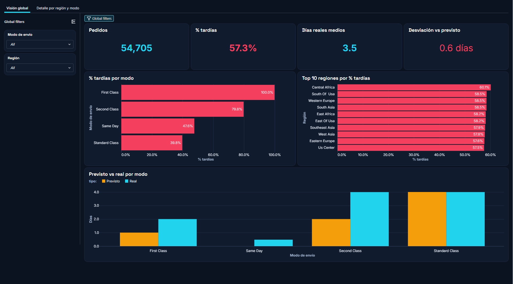
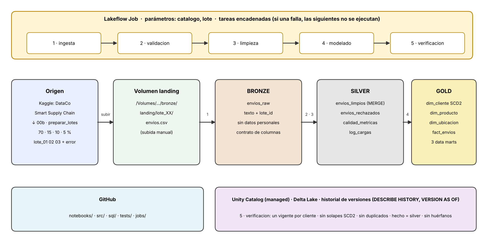
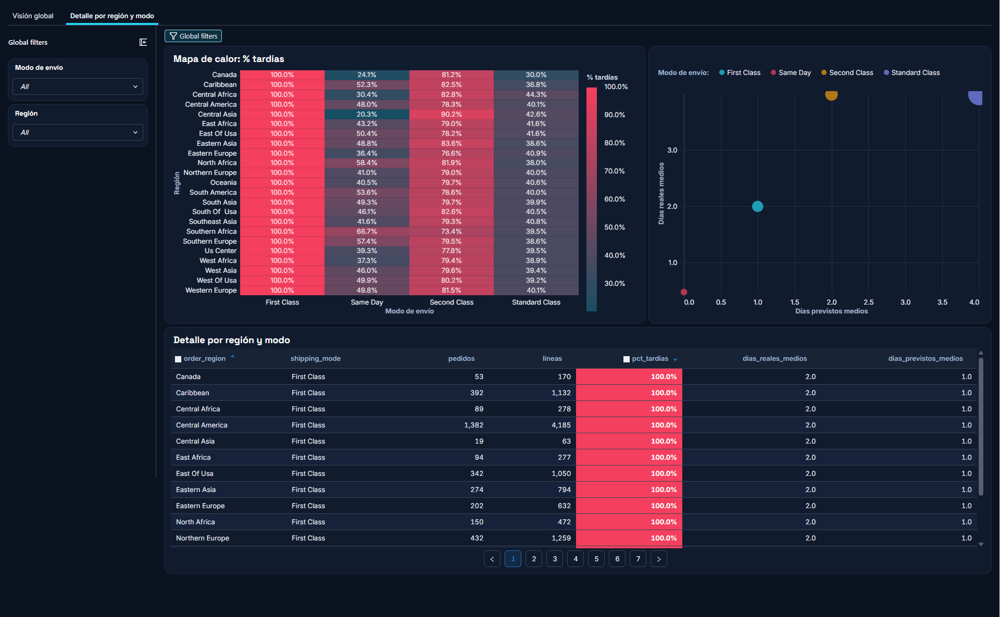
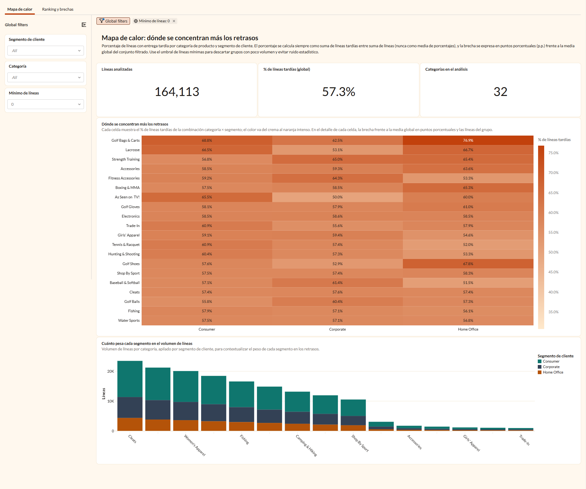
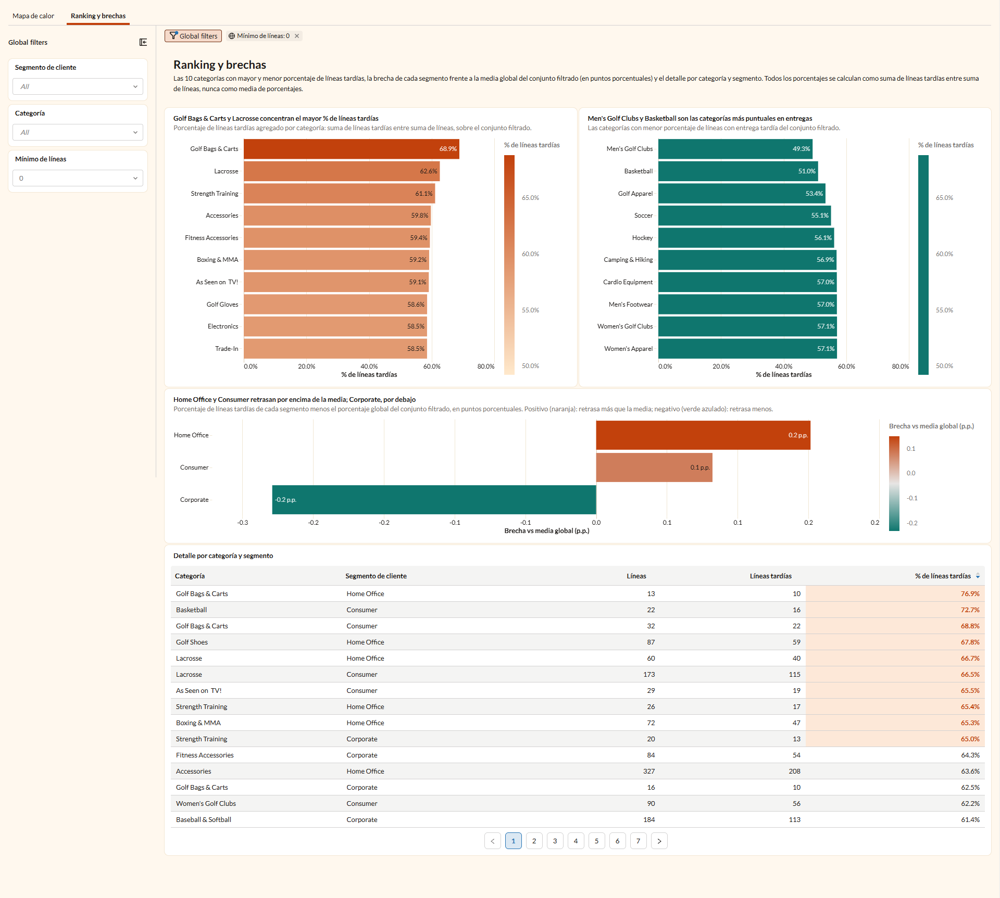
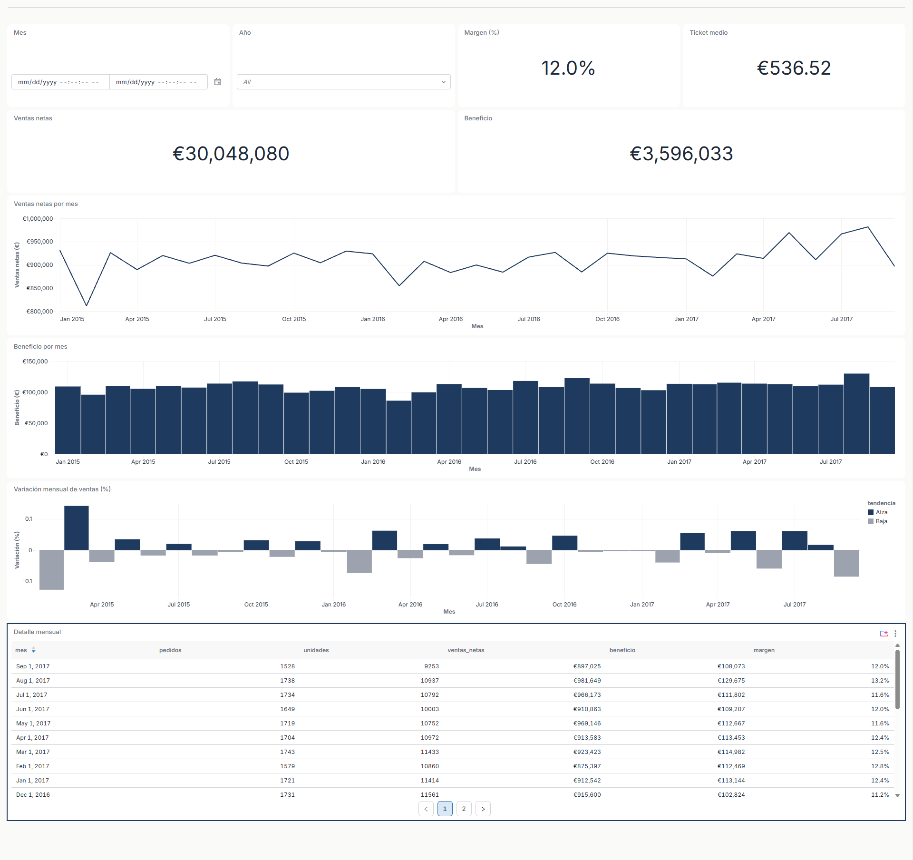

<div align="center">

# 🚚 Logística DataCo
### Cargas incrementales con SCD Tipo 2 en Databricks

Pipeline **Medallion** (Bronze → Silver → Gold) orquestado con **Lakeflow Jobs** sobre el dataset
[DataCo Smart Supply Chain](https://www.kaggle.com/datasets/shashwatwork/dataco-smart-supply-chain-for-big-data-analysis) de Kaggle,
con `MERGE`, historial de clientes (SCD Tipo 2), calidad de datos, fallo controlado y tres dashboards.


<br>



<br>

### 📘 Memoria completa, paso a paso: **[DataCo.pdf](DataCo.pdf)**

</div>

## 🎯 Visión general

El dataset de DataCo es una **foto estática** de unas 180 000 líneas de pedido. Para trabajar con **cargas incrementales** como en un entorno real, se ordena por fecha de pedido y se reparte en lotes que llegan "a lo largo del tiempo". Cada lote atraviesa un pipeline que valida, limpia, modela y verifica los datos, y el resultado alimenta **tres data marts** explotados en **tres dashboards**.

Lo que lo hace parecido a un proyecto de empresa:

- **Incremental e idempotente:** reprocesar un lote no duplica ni modifica nada.
- **Historial de clientes (SCD Tipo 2):** cuando un cliente cambia de segmento, se cierra su versión y se abre otra.
- **Calidad de datos:** contrato de columnas, reglas de calidad, filas rechazadas con su motivo y puerta de calidad.
- **Orquestado y observable:** un Lakeflow Job de 5 tareas con parámetros, monitorización y linaje.
- **Falla bien:** un lote defectuoso detiene el job sin tocar las tablas de consumo.
- **Reproducible** en **Databricks Free Edition** (cómputo serverless) y con pruebas automáticas.

---

## 🏗️ Arquitectura

<div align="center">

</div>

```
Kaggle CSV ─▶ 00b_generar_lotes ─▶ lote_XX/envios.csv ─▶ Volumen "landing"
                                                          │
          Lakeflow Job (parámetro: lote)                  ▼
 ┌───────────┐   ┌────────────┐   ┌──────────┐   ┌──────────┐   ┌──────────────┐
 │  ingesta  │ ─▶│ validacion │ ─▶│ limpieza │ ─▶│ modelado │ ─▶│ verificacion │
 │  Bronze   │   │ reglas +   │   │  MERGE   │   │ SCD2 +   │   │ 10 controles │
 │ (contrato)│   │ rechazos   │   │ a Silver │   │ hechos + │   │ de integridad│
 └───────────┘   └────────────┘   └──────────┘   │ marts    │   └──────────────┘
                                                 └──────────┘
```

**Modelo en Gold**

| Tabla | Tipo | Cómo se mantiene |
|---|---|---|
| `dim_cliente` | **SCD Tipo 2** | cierra la versión vigente y abre otra si cambia el segmento o la ubicación |
| `dim_producto` | SCD Tipo 1 | sobrescribe atributos |
| `dim_ubicacion` | Estática | solo inserta ubicaciones nuevas |
| `fact_envios` | Hechos | upsert por `(order_id, order_item_id)`; conserva el `customer_sk` con el que se cargó |
| `mart_*` (×3) | Data marts | se reconstruyen desde el hecho y las dimensiones |

---

## 🧭 Qué se hace, fase a fase

Sigue el mismo orden que [`DataCo.pdf`](docs/DataCo.pdf).

| # | Fase | Qué se hace | PDF |
|---|---|---|---|
| 1 | **Entorno** | Catálogo `logistica_dataco` en Unity Catalog con esquemas `bronze`, `silver` y `gold` y volúmenes `raw` y `landing` | p. 2 |
| 2 | **Datos y lotes** | Se sube el CSV de Kaggle y `00b_generar_lotes` lo divide en `lote_01` (70 %), `lote_02` (15 %), `lote_03` (10 %) y `lote_error` (5 %) | p. 3 |
| 3 | **Ingesta** · `01_ingesta` | Lee el CSV, **comprueba el contrato de columnas**, pasa a `snake_case`, descarta columnas sensibles y añade metadatos de carga | p. 6 |
| 4 | **Validación** · `02_validacion` | **6 reglas de calidad**: lo válido va a `stg_validos`, lo inválido a `envios_rechazados` con su motivo, y se guardan métricas. Si se rechaza más del 50 % del lote, falla | p. 8 |
| 5 | **Limpieza** · `03_limpieza` | Deduplica y hace `MERGE` en Silver: inserta lo nuevo, actualiza lo que cambió y no toca lo idéntico | p. 9 |
| 6 | **Modelado** · `04_modelado` | Dimensiones (SCD2 y SCD1), tabla de hechos y **3 data marts** | p. 10 |
| 7 | **Verificación** · `05_verificacion` | **10 comprobaciones de integridad**; si una falla, la tarea falla | p. 11 |
| 8 | **Lakeflow Job** | Los 5 notebooks encadenados en un job con parámetros `catalogo` y `lote` | p. 13 |
| 9 | **Demostración incremental** | Carga inicial, segunda y tercera carga, y comparación "antes y después" con el historial de Delta (`DESCRIBE HISTORY`, `VERSION AS OF`) | p. 16 |
| 10 | **Ejecución con error** | `lote_error` (sin la columna `Customer Id`) hace fallar el job en `ingesta`; Gold queda intacto y no llega nada a Bronze | p. 23 |
| 11 | **Monitorización y linaje** | Historial de ejecuciones, estado por tarea y grafo de linaje de la tabla de hechos | p. 25-27 |
| 12 | **Dashboards** | Los tres data marts explotados en tres dashboards de Databricks | p. 28-31 |

### Cómo se simulan las cargas

| Lote | % | Contenido |
|---|---|---|
| `lote_01` | 70 % | Carga inicial: los pedidos más antiguos, sin modificar |
| `lote_02` | 15 % | Segunda carga |
| `lote_03` | 10 % | Tercera carga |
| `lote_error` | 5 % | Los pedidos más recientes, **sin la columna `Customer Id`** (error provocado) |

En `lote_02` y `lote_03` se cambia a propósito el `Customer Segment` de un grupo de clientes que ya existían en `lote_01`. Es lo único modificado del dataset y sirve para que el SCD Tipo 2 cierre versiones. Está **declarado como simulado** en la memoria.

---

## 📊 Resultados

Ejecución real en Databricks Free Edition (detalle en [`DataCo.pdf`](docs/DataCo.pdf), p. 16-26).

**Cargas incrementales**

| Carga | Filas cargadas | Versiones abiertas en `dim_cliente` | Versiones cerradas (SCD2) |
|---|---:|---:|---:|
| `lote_01` | 126 363 | 12 035 | 0 |
| `lote_02` | 27 078 | 237 | 20 |
| `lote_03` | 18 052 | 92 | 14 |

- **SCD Tipo 2 en acción:** 34 clientes con dos versiones, la antigua cerrada (`es_vigente = false`) y la nueva abierta (`fecha_fin = 9999-12-31`).
- **Verificación:** las 10 comprobaciones de integridad devuelven 0 filas incorrectas.
- **Idempotencia:** reprocesar un lote no inserta ni actualiza nada y no crea versiones nuevas.
- **Duración:** ≈ 3 min la carga inicial y ≈ 2 min las incrementales (cómputo serverless).
- **Fallo controlado:** con `lote_error`, `ingesta` falla con `ErrorContrato` (falta `customer_id`), las tareas siguientes no se ejecutan, `fact_envios` no recibe ninguna versión nueva y `bronze.envios_raw` tiene `0` filas de ese lote.

---

## 📈 Dashboards

Los tres data marts se explotan en tres dashboards de Databricks creados con ayuda de **Genie**, cada uno con un estilo distinto. Los ficheros `.json` están en [`dashboards/`](dashboards/) y se pueden importar en el workspace.

### 1 · Control de Logística — `mart_entregas_modo_region`
Tema oscuro tipo centro de control, con dos páginas: *Visión global* y *Detalle por región y modo*. Filtros por modo de envío y región.

<p align="center">
  <br><br>
  
</p>

### 2 · Radar de Retrasos — `mart_retraso_categoria_segmento`
Estilo editorial en tonos cálidos: mapa de calor de retrasos y ranking de categorías con la brecha de cada segmento frente a la media. Filtros por segmento, categoría y mínimo de líneas.

<p align="center">
  <br><br>
  
</p>

### 3 · Ventas — `mart_ventas_mensuales`
Minimalista y sobrio, de una sola página: ventas netas, beneficio, margen, ticket medio y evolución mensual. Filtros por rango de fechas y año.

<p align="center">
  
</p>

---

## 🗂️ Estructura del repositorio

```
.
├── README.md
├── DataCo.pdf            memoria y guía paso a paso completa con capturas
├── images/               capturas de los dashboards
├── notebooks/            00_setup_catalogo · 00b_generar_lotes · 01_ingesta · 02_validacion
│                         03_limpieza · 04_modelado · 05_verificacion
├── src/                  config · esquema · transformaciones · sql_merges · sql_marts
│                         verificaciones · utilidades · preparar_lotes
├── sql/                  catálogo y tablas · consultas · data marts · reinicio de tablas
├── dashboards/           los 3 dashboards en .json, listos para importar
```

---

<div align="center">

**Christian Salguero Varas** · Proyecto práctico de la certificación **DP-750**

</div>
